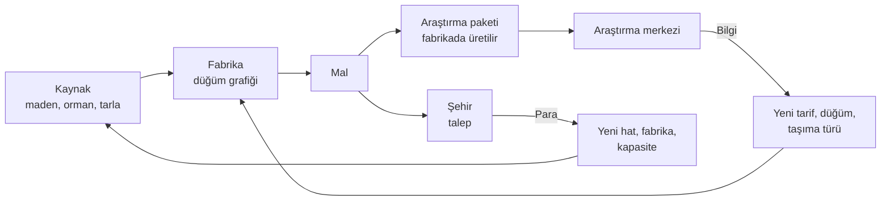
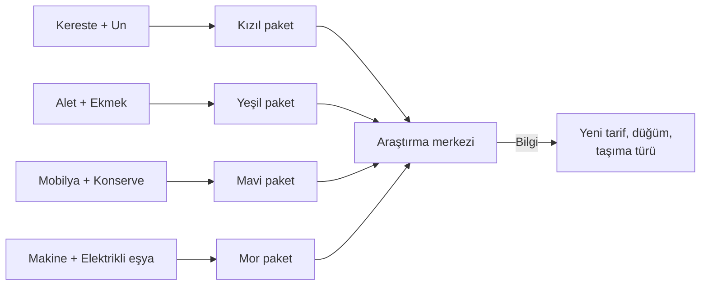

# flowgame — Tasarım Dokümanı

Sep 23, 2026 · @tayfun

## Özet

flowgame, 20 bölgelik sabit bir haritada kaynakları şehirlere taşıyan ve fabrikaların içini düğüm grafiğiyle kuran, zaman baskısı olmayan bir üretim-lojistik sandbox'ıdır. Harita katmanı Transport INC'den, fabrika içi Upload Labs'tan, araştırma mantığı Factorio'nun bilim paketlerinden esinlenir.

**Oyuncu fantezisi:** "Boş bir bölgeden başlayıp akan, kendi kendini besleyen bir sanayi ağı kurdum."

**Tasarım ilkeleri**

- **Zaman baskısı yok.** Kaybetme durumu, geri sayım ya da ceza yok; gerilim fırsat maliyetinden gelir.
- **Ödül, ceza değil.** Beslenen şehir büyür; beslenmeyen şehir küçülmez, sadece büyümez.
- **Oyuncu kararları elinde tutar.** Rota, fabrika içi bağlantılar ve malın nereye gideceği her zaman oyuncunun seçimi (Transport INC'nin hatasının tersi).
- **Soyut akış.** Araçlar tek tek değil, hatlar üzerinde birim/dk akış olarak simüle edilir; oyun büyüdükçe yavaşlamaz.
- **Her kademe yeni zincir.** İlerleme, aynı fabrikayı kopyalamakla değil, yeni ve daha karmaşık zincirler kurmakla olur.

## Ana döngü

Oyunun tek kararı şudur: üretilen mal şehre satılıp para mu olacak, yoksa araştırma paketine dönüştürülüp bilgi mi olacak. Para kapasiteyi, araştırma yeteneği büyütür.

**İki para birimi**

| Birim | Nereden gelir | Neye harcanır |
| --- | --- | --- |
| Para | Şehirlere mal satmak | Bina, hat, araç, bakım, bölge erişimi |
| Araştırma puanı | Fabrikada üretilen araştırma paketlerini merkeze teslim etmek | Araştırma ağacındaki düğümler |

**Oyuncu ritmi:** Büyü (para) → takıl (yeni mal lazım) → araştır (malı araştırmaya yönlendir) → yeni zincir kur → tekrar büyü.

## Harita katmanı

Harita en fazla 20 sabit bölgeden oluşur ve yalnızca kaynakları, şehirleri ve aradaki mesafeyi taşır; siyaset, sahiplik ya da düşman yoktur.

**Bölge içeriği**

- **Kaynak yatakları:** Her bölgede 1–3 kaynak, her biri sabit çıkarım hızına sahip (ör. Demir cevheri 20 birim/dk). Yataklar tükenmez.
- **Şehir:** Bölgelerin yaklaşık yarısında bir şehir bulunur. Şehirler talep üretir ve büyür (Ekonomi bölümü).
- **Fabrika slotları:** Her bölgede sınırlı sayıda (2–4) fabrika alanı. Bu kural, tüm üretimi tek bölgeye yığmayı engeller ve lojistiği zorunlu kılar.

**Harita noktaları:** Haritada üç tür nokta vardır: ham madde alanı (maden, orman, tarla; bölgenin kaynak yatakları), fabrika (bölgenin fabrika alanlarına kurulur) ve şehir. Noktalar bölgelerin içindedir; bölge açmak içindeki noktalara erişim verir. Lojistik hatları noktalar arasında kurulur. Noktalar bölge verisinden (kaynak listesi, fabrika alanı sayısı, şehir) otomatik yerleştirilir. Yerleşim bir kez üretilir ve sabittir: her oyunda aynıdır; gerekirse elle düzeltilebilir.

**Bölge açma:** Oyun 1 açık bölgeyle başlar. Kilitli bir bölge yalnızca açık bir bölgeye komşuysa para ile (erişim izni) açılabilir; açılan bölge bir daha kilitlenmez. Bu, paranın oyun ortasındaki ana harcama kalemlerinden biridir.

**Araştırma merkezi:** Haritada fiziksel bir bina. Oyuncu ilkini başlangıç bölgesine kurar; sonradan ikinci bir merkez kurulabilir. Araştırma paketlerini buraya taşımak ayrı bir lojistik karardır.

**Godot uygulaması:** Her bölge `Area2D` + `Polygon2D` + `CollisionPolygon2D` + `Line2D`; veri `RegionData` Resource'unda. PNG tabanlı ID haritası kullanılmaz.

## Fabrika içi

Her fabrika açıldığında Upload Labs tarzı bir düğüm editorüne dönüşür: oyuncu makineleri düğüm olarak yerleştirir ve çıkışları girişlere bağlar. Idle değil; kurulan sistem sabit hızda çalışır, oyuncu tıklayarak üretim yapmaz.

**Mevcut editör:** Fabrika içi sıfırdan yazılmaz. Iron & Ember'in düğüm editörü ve parça simülasyonu kullanılır: mallar düğümler arasında tek tek, kuyruklarda bekleyen parçalar olarak akar. Ondan yalnızca genel bloklar alınır (işleyici, ayırıcı, depo, jeneratör). Maden, satış ve ticaret blokları (Iron Mine, Collector, Trade Depot, Trade Network, Power Exchange) alınmaz, çünkü o işleri harita yapar. Tarifler yeni oyunun mallarıyla kurulur.

**Düğüm tipleri**

| Düğüm | Görevi | Örnek |
| --- | --- | --- |
| Giriş kapısı | Hattan gelen malı fabrikaya alır | Demir cevheri 20/dk |
| İşleyici | Bir tarifi uygular (girdi → çıktı) | Ergitici: 2 cevher → 1 kütük |
| Birleştirici | İki farklı girdiden bir çıktı üretir | Montaj: 1 kütük + 2 kereste → 1 alet |
| Ayırıcı | Akışı oranla böler | %70 satış, %30 araştırma |
| Depo | Tampon; akış dalgalanmasını emer | 200 birim kapasite |
| Çıkış kapısı | Malı hatta verir | Aletler → Şehir X |

**Kapılar ve hatlar:** Her mal için bir kapı vardır. Fabrikaya kaç hattan gelirse gelsin, aynı mal tek bir giriş kapısında toplanır; çıkış kapıları da mal başınadır. Kapılar haritadaki birim/dk akışı parçalara, fabrikadan çıkan parçaları da yeniden birim/dk akışa çevirir.

**Fabrika stokları:** Fabrikada her mal için iki ayrı stok vardır (her biri yer tutucu 50 birim).

- **Giriş stoğu:** Hatların getirdiği mal buraya konur ve o malın giriş kapısı buradan çeker.
- **Çıkış stoğu:** Çıkış kapısı malı buraya koyar. Fabrikadan çıkan hatlar yalnızca bu stoktan alır; hangi hatta ne kadar gideceğini haritadaki yük seçimi belirler. Editör hatları bilmez.

Kullanılmayan bir malın giriş stoğu dolunca o mal fabrikaya taşınmaz ve payı diğer mallara geçer. Çıkış stoğu dolunca çıkış kapısı mal almayı bırakır: parçalar içeride kuyruklarda birikir, işleyiciler durur ve haritadaki uyarı işareti yanar. Giriş kapısı doğrudan çıkış kapısına bağlanabilir; böylece fabrika, malları bir hattan diğerine aktaran bir durak olarak da kullanılabilir.

**Kısıtlar (bulmacayı yaratan şeyler)**

- **Bağlantı kapasitesi:** Her bağlantı en fazla belirli bir hız taşır (ör. 30 birim/dk); fazlası için paralel hat gerekir.
- **Enerji:** Seviye 2'den itibaren işleyiciler enerji ister; enerji üretimi de bir düğümdür (kömür → enerji).

**Tekrarı önleme:** Oyuncu kurduğu düğüm grubunu şablon olarak kaydedip başka fabrikaya yapıştırabilir. Bölgelerin farklı kaynak ve enerji koşulları, şablonun her yerde birebir çalışmamasını sağlar.

**Haritadan fabrikaya geçiş**

- **Kurulum:** Arsaya fabrika kurmak yalnızca kurulum bedelini öder; tarif seçilmez. Fabrikanın içi boş gelir.
- **Giriş kapıları kendiliğinden:** Bir hat fabrikaya mal getirmeye başlayınca o malın giriş kapısı editörde kendiliğinden belirir. İşleyicileri ve çıkış kapılarını oyuncu yerleştirir.
- **Girip çıkma:** Arsa panelindeki "Open factory" düğmesi editörü tam ekran açar, harita gizlenir. "Back to map" düğmesi ya da Esc ile haritaya dönülür.
- **Zaman:** Tek bir oyun saati vardır. Oyuncu fabrikanın içindeyken harita, hatlar ve diğer fabrikalar çalışmaya devam eder. Hız düğmeleri editörde de görünür; oyuncu isterse duraklatır.
- **Haritadaki özet:** Arsa panelinde her mal için giren ve çıkan birim/dk görünür. Girdisi eksik ya da çıkışı dolu fabrikanın haritadaki simgesinde uyarı işareti yanar.

**Godot uygulaması:** Editör için yerleşik `GraphEdit` + `GraphNode` kullanılır; bağlantılar `connection_request` sinyaliyle yönetilir.

**Geçici sabit fabrika:** Düğüm editörü gelene kadar fabrika kurulurken tek bir tarif seçilir (Bıçkıhane: Tomruk → Kereste veya Değirmen: 2 Buğday → Un) ve sonra değişmez. Bu geçici bir çözümdür: kalıcı tasarımda fabrikanın türü yoktur, içini oyuncu düğümlerle kurar.

## Lojistik ve akış modeli

Noktalar arası taşıma, hatlar üzerinde birim/dk akış olarak hesaplanır.

**Oyun saati:** 1 oyun dakikası = 1 gerçek dakika. Oyuncu hızı Duraklat / x1 / x2 / x4 ile değiştirebilir.

**Hat kurma:** Oyuncu iki noktayı seçer; hat bu iki noktayı bağlar. Hat yalnızca açık bölgelerdeki noktalar arasında kurulur; hattın çizgisi kilitli bir bölgenin üstünden geçebilir, önemli olan iki ucudur. Mesafe iki nokta arasındaki düz uzaklıktır. Coğrafi parametre (arazi, dağ vb.) yoktur.

**Araç turu:** Her hatta oyuncunun eklediği araçlar çalışır. Araç belirli bir yük taşır ve gidiş-dönüş yapar; hattın kapasitesi = araç sayısı × araç yükü ÷ tur süresi. Uzun hat daha az birim/dk taşır; oyuncu araç ekleyerek telafi eder. Araçlar tek tek simüle edilmez: akış bu formülle soyut olarak hesaplanır, haritadaki araçlar görseldir. Kapasite = araç yükü × hız ÷ (2 × mesafe); yükleme süresi yoktur.

**Yön:** Hat çift yönlüdür; araç dönüşte de yük alır.

**Maliyet:** Hat kurmak sabit ve ucuzdur; asıl gider araçtır: araç başına alış fiyatı ve dakika başı bakım. Mesafenin bedeli, aynı akış için gereken fazladan araçlardır; kuruluma mesafe ücreti eklenmez.

**Tek hat:** İki nokta arasında yalnızca bir hat olur; kapasite araç ekleyerek artar. Bir noktaya bağlanabilecek hat sayısı sınırsızdır.

**Yük seçimi:** Oyuncu her yön için taşınacak malları ve oranlarını seçer (ör. Tomruk %60, Buğday %40). Bir malın arzı payını dolduramazsa kalan pay diğer mallara geçer.

**Taşıma türleri**

| Tür | Araç yükü | Hız (birim/dk) | Araç fiyatı | Araç bakımı (/dk) | Hat kurulumu | Açılış |
| --- | --- | --- | --- | --- | --- | --- |
| At arabası | 10 | 300 | 50 | 1 | 20 | Başlangıç |
| Kamyon yolu | 30 | 400 | 200 | 3 | 20 | Kademe 1 |
| Demiryolu | Açık | Açık | Açık | Açık | Açık | Kademe 2 |
| Boru hattı (sıvı) | Açık | Açık | Açık | Açık | Açık | Kademe 3 |

Mesafe harita birimiyle ölçülür (başlangıç bölgesinin içi yaklaşık 100–200, haritanın bir ucundan öbürüne yaklaşık 1.400).

**Akış kuralları**

- Hat kapasitesi dolarsa kaynak tarafında birikir; üretim durmaz, depo dolunca yavaşlar.

**Stok ve kabul:** Her noktada mal başına küçük bir stok vardır (yer tutucu: 50 birim). Yatak ürettiğini kendi stoğuna koyar; stok dolunca üretim durur. Hat bir malı yalnızca varış noktası kabul ediyorsa taşır: fabrika her malı kabul eder (geçici sabit fabrika yalnızca tarifinin girdilerini), şehir talep ettiği malları kabul eder; ham madde alanı ve boş arsa hiçbir şey kabul etmez. Şehrin stok sınırı yoktur; mal gelir gelmez doygunluk fiyatıyla satılır. Hat kurulunca varış noktasının kabul ettiği mallar eşit paylarla seçili gelir. Varış stoku dolu olan mal taşınmaz; payı diğer mallara geçer.

**Neden bu model:** Transport INC 30 araçtan sonra çöküyordu. Akış hesabı 20 bölge ve yüzlerce bağlantıda bile sabit maliyetlidir.

## Ekonomi ve şehir talebi

Şehirler seviyeye göre artan ve çeşitlenen bir talep listesi tutar; talebi karşılanan şehir büyür, karşılanmayan şehir olduğu yerde kalır.

**Şehir seviyeleri**

| Seviye | Talep edilen mallar | Büyüme koşulu |
| --- | --- | --- |
| Köy | Kereste, Un | — |
| Kasaba | + Ekmek, Alet | Köy taleplerinin %80'i 5 dk boyunca karşılanır |
| Şehir | + Mobilya, Konserve | Kasaba taleplerinin %80'i 5 dk boyunca karşılanır |
| Metropol | + Makine, Elektrikli eşya | Şehir taleplerinin %80'i 5 dk boyunca karşılanır |

**Doygunluk fiyatı:** Talebin %100'üne kadar mal tam fiyattan satılır. Fazlası için fiyat hızla düşer (%100–150 arası yarı fiyat, %150 üstü %10). Bu kural iki şeyi zorunlu kılar: oyuncu farklı mallar üretir ve fazla üretimi doğal olarak araştırma paketi üretimine yönlendirir.

**Ham mal satılmaz:** Ham mal şehre satılamaz; şehirler yalnızca fabrikada işlenmiş mal alır.

**Borç:** Bakım yüzünden para eksiye düşebilir. Para eksideyken yeni alım yapılamaz, ama hiçbir şey kapanmaz ya da durmaz.

**Ceza yok:** Şehir asla seviye kaybetmez ve memnuniyeti zamanla düşmez. Beslenmeyen talep sadece büyümeyi bekletir.

**Para giderleri (paranın oyun ortasında anlamsızlaşmaması için)**

- Araç ve fabrika bakımı (sürekli, dakika başı)
- Yeni fabrika ve fabrika seviye yükseltmesi
- Bölge erişim izni
- Kademe 4'ten itibaren: araştırmayı para ile hızlandırma (malın yerini tutmaz, sadece süreyi kısaltır)

## Araştırma ağacı

Araştırma, Factorio'daki gibi araştırma paketleriyle yapılır. Paketler fabrikalarda, şehirlerin de talep ettiği mallardan normal bir tarifle üretilir ve araştırma merkezine taşınır; merkez yalnızca paket kabul eder. Her kademe yeni bir paket rengi getirir ve üst kademe araştırmaları alt kademe paketlerini de ister, bu yüzden eski zincirler kapanmaz, yenileri üzerlerine eklenir.

**Araştırma paketleri**

| Paket | Tarif (girdi → 1 paket) | Atölye hızı (paket/dk) | Tarifi açan |
| --- | --- | --- | --- |
| Kızıl | 1 Kereste + 1 Un | 10 | Başlangıç |
| Yeşil | 1 Alet + 1 Ekmek | 5 | Kademe 1 |
| Mavi | 1 Mobilya + 1 Konserve | 3 | Kademe 2 |
| Mor | 1 Makine + 1 Elektrikli eşya | 2 | Kademe 3 |

**Kademe içeriği**

| Kademe | Gereken paketler | Açtığı düğümler |
| --- | --- | --- |
| 1 | Kızıl | Ergitici, Fırın tarifleri · Yeşil paket · Kamyon yolu · Fabrika Seviye 2 |
| 2 | Kızıl + Yeşil | Marangoz, Konserve hattı · Mavi paket · Demiryolu · Enerji düğümü · Şablon kaydetme |
| 3 | Kızıl + Yeşil + Mavi | Makine atölyesi, Elektrik montajı · Mor paket · Boru hattı · Fabrika Seviye 3 |
| 4 | Kızıl + Yeşil + Mavi + Mor | Verimlilik yükseltmeleri (+%20 işleyici hızı) · İkinci araştırma merkezi · Para ile hızlandırma |

Başlangıçta açık tarifler: Bıçkıhane (Tomruk → Kereste), Değirmen (Buğday → Un).

**Kurallar**

- Her kademe 3–5 düğümden oluşur; bir kademenin tüm düğümlerini bitirmek gerekmez, bir sonraki kademe kademe çekirdeği (tarif düğümü) bitince açılır.
- Araştırma merkezi paketleri teslim edildikçe tüketir; birden fazla renk isteyen araştırmada her renkten eşit sayıda gerekir ve ilerleme en yavaş gelen renkle dolar. Paketler şehirlere satılamaz.
- Aynı anda tek araştırma yürür (Kademe 4'te ikinci merkezle iki).

## İlk denge sayıları

Bu sayılar prototipte ayarlanacak başlangıç tahminleridir. Temel kural: bir araştırma kademesinin çekirdek maliyeti, ilgili paketlerin 10–25 dakikalık üretimine denk gelir.

**Hammaddeler**

| Kaynak | Yatak başına çıkarım (birim/dk) |
| --- | --- |
| Tomruk | 20 |
| Buğday | 20 |
| Demir cevheri | 20 |
| Kömür | 15 |
| Bakır cevheri | 15 |

**Mallar, tarifler ve şehir fiyatları**

| Mal | Tarif (girdi → 1 birim) | İşleyici hızı (birim/dk) | Şehir fiyatı |
| --- | --- | --- | --- |
| Kereste | 1 Tomruk | 10 | 1 |
| Demir külçe | 2 Demir cevheri | 10 | Satılmaz |
| Un | 2 Buğday | 10 | 1 |
| Ekmek | 1 Un | 10 | 4 |
| Alet | 1 Demir külçe + 1 Kereste | 10 | 6 |
| Konserve | 1 Demir külçe + 2 Buğday | 8 | 8 |
| Mobilya | 3 Kereste + 1 Alet | 5 | 18 |
| Bakır külçe | 2 Bakır cevheri | 8 | Satılmaz |
| Makine | 2 Demir külçe + 1 Alet + enerji | 5 | 25 |
| Elektrikli eşya | 2 Bakır külçe + 1 Demir külçe + enerji | 5 | 22 |

Enerji: 1 Kömür/dk bir enerji isteyen işleyiciyi çalıştırır.

**Araştırma çekirdek maliyetleri**

| Kademe | Maliyet | Paket üretimi o an (/dk) | Süre (tam yönlendirme) | Kaybedilen satış geliri |
| --- | --- | --- | --- | --- |
| 1 | 100 Kızıl | 10 | \~10 dk | 200 |
| 2 | 80 Kızıl + 80 Yeşil | 10 + 5 | \~16 dk | 960 |
| 3 | 60 Kızıl + 60 Yeşil + 60 Mavi | 10 + 5 + 3 | \~20 dk | 2.280 |
| 4 | 50 Kızıl + 50 Yeşil + 50 Mavi + 50 Mor | 10 + 5 + 3 + 2 | \~25 dk | 4.250 |

Kademedeki diğer düğümler çekirdek maliyetin %50–75'i kadardır.

**Para değerleri**

| Kalem | Değer |
| --- | --- |
| Başlangıç parası | 1.000 |
| Yeni fabrika (Seviye 1) | 300 |
| Fabrika Seviye 2 / Seviye 3 | 800 / 2.000 |
| Fabrika bakımı | 3 /dk (seviye başına) |
| Bölge erişim izni | 500, sonraki her bölge +250 |
| Köy talebi | Kereste 10 + Un 10 /dk → en fazla 20 para/dk |
| Kasaba ek talebi | Ekmek 8 + Alet 5 /dk → en fazla +62 para/dk |

**Hedef oyun süresi:** Prototip döngüsü 1–2 saat; tam oyun Kademe 4 sonuna kadar 15–25 saat.

## Prototip kapsamı

Prototip tek bir soruyu cevaplar: "sat mı, araştır mı" kararı ve fabrika içi düğüm kurmak 1 saat boyunca eğlenceli mi? Grafik, ses ve menüler yer tutucu kalır.

**İçerik**

| Alan | Prototipte | Tam oyunda |
| --- | --- | --- |
| Bölge | 5 (2 şehirli) | 20 |
| Hammadde | Tomruk, Buğday, Demir cevheri | 5 |
| Mal | Kereste, Un, Demir külçe, Ekmek, Alet + Kızıl ve Yeşil paket | 12 |
| Araştırma | Kademe 1 ve 2 (6 düğüm) | 4 kademe |
| Taşıma | At arabası, Kamyon yolu | 4 tür |
| Şehir seviyesi | Köy, Kasaba | 4 seviye |
| Düğüm tipleri | Giriş, İşleyici, Birleştirici, Ayırıcı, Çıkış | + Depo, Enerji, Şablon |

**Geliştirme sırası**

1. 5 bölgelik harita, tıklama ve bilgi paneli
2. Harita noktaları (ham madde alanı, fabrika arsası, şehir)
3. Hat kurma: noktaları bağlama, araç ekleme, kapasite gösterimi, görsel araçlar
4. Akış simülasyonu, yük seçimi, geçici sabit fabrika, köy talebi ve doygunluk fiyatı
5. Fabrika içi `GraphEdit` editörü (sabit fabrikanın yerini alır)
6. Şehir büyümesi (köy → kasaba) ve kasaba talebi
7. Araştırma paketleri, araştırma merkezi ve 6 düğüm

**Başarı ölçütü:** 3–5 kişi oynar. Oyuncuların çoğu Kademe 2'ye kendiliğinden ulaşıyor, en az bir kez "şimdi mi araştırsam" diye duraksadığını söylüyor ve 1 saatin sonunda devam etmek istiyorsa döngü tutuyor demektir. Tutmuyorsa önce doygunluk ve araştırma maliyetleri ayarlanır, sonra kapsam büyütülür.

## Riskler ve açık sorular

**Riskler**

| Risk | Nereden biliyoruz | Önlem |
| --- | --- | --- |
| Baskısız sandbox amacını kaybeder | Deep Corp'ta uzun oynayanlar hedeflerden keyif alıyor | Şehir büyümesi ve araştırma kademeleri görünür hedef olarak ekranda |
| Aynı fabrikayı tekrar tekrar kurmak | Deep Corp incelemelerindeki "tekrar eden zincirler" şikayeti | Her kademe yeni zincir, şablon kaydetme, bölgeye özel koşullar |
| İki katman arasında dikkat bölünmesi | Harita + fabrika içi iki ayrı ekran | Haritada fabrika üzerinde akış özeti; sorunlu fabrika işaretlenir |
| Büyüyünce yavaşlama | Transport INC 30 araçtan sonra çöküyordu | Araç yerine akış simülasyonu |
| Tek kişi için kapsam fazla | Aslında iki oyun | Prototip sınırlarına sadık kalmak, döngü tutmadan büyütmemek |

**Açık sorular**

- [ ] Oyunun tematik dönemi ne olacak: sanayi devrimi mi, zamansız/stilize bir dünya mı?
- [ ] Oyunun bir bitişi olacak mı (ör. tüm şehirler Metropol), yoksa sonsuz sandbox mı?
- [ ] İsteyene açık senaryo modu (hedefli haritalar) eklenecek mi?
- [ ] Fiyat modeli: ücretli mi, Upload Labs gibi ücretsiz + destekçi paketi mi? Demo planlanıyor mu?
- [ ] Mobil hedefleniyor mu? Düğüm editörü dokunmatik ekranda kullanışlı olmalı mı?
- [ ] Erken ekonomi çok sıkışık: köy en fazla 20 para/dk getiriyor, iki fabrikanın bakımı 6/dk tutuyor ve ilk bölge izni 500; ilk bölge yaklaşık 50 dakikada açılabiliyor. Köy fiyatları, fabrika bakımı ya da bölge izni, akış simülasyonu çalışınca gerçek sayılarla ayarlanacak.
- [ ] Araştırma merkezi dördüncü nokta türü mü?
- [ ] Düğüm sınırı kalktı. Fabrika Seviye 2 ve 3 (araştırmada ve maliyet tablosunda geçiyor) artık neyi açıyor?
- [ ] Fabrika içi tek tek parça simülasyonu kullanıyor. Çok fabrikalı oyunda yavaşlarsa ne yapılacak? (Risk tablosundaki "Büyüyünce yavaşlama" satırıyla ilgili.)
