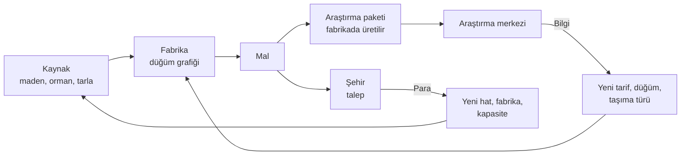
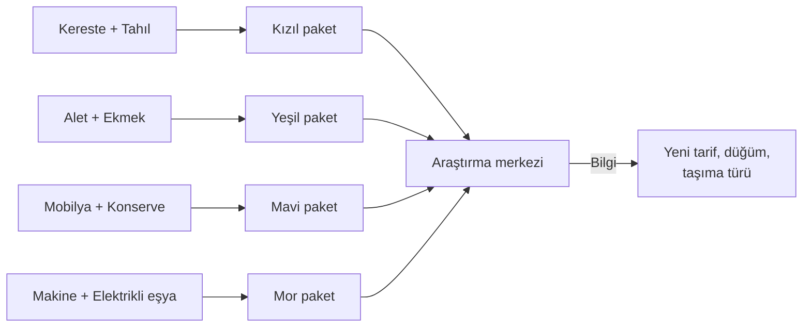

# flowgame — Tasarım Dokümanı

Sep 23, 2026 · @tayfun

## Özet

flowgame, 20 bölgelik sabit bir haritada kaynakları şehirlere taşıyan ve fabrikaların içini düğüm grafiğiyle kuran, zaman baskısı olmayan bir üretim-lojistik sandbox'ıdır. Harita katmanı Transport INC'den, fabrika içi Upload Labs'tan, araştırma mantığı Factorio'nun bilim paketlerinden esinlenir.

**Oyuncu fantezisi:** "Boş bir bölgeden başlayıp akan, kendi kendini besleyen bir sanayi ağı kurdum."

**Tasarım ilkeleri**

- **Zaman baskısı yok.** Kaybetme durumu, geri sayım ya da ceza yok; gerilim fırsat maliyetinden gelir.
- **Ödül, ceza değil.** Beslenen şehir büyür; beslenmeyen şehir küçülmez, sadece büyümez.
- **Oyuncu kararları elinde tutar.** Rota, fabrika içi bağlantılar ve malın nereye gideceği her zaman oyuncunun seçimi (Transport INC'nin hatasının tersi).
- **Soyut akış.** Araçlar tek tek değil, hatlar üzerinde birim/dk akış olarak simüle edilir; oyun büyüdükçe yavaşlamaz.
- **Her kademe yeni zincir.** İlerleme, aynı fabrikayı kopyalamakla değil, yeni ve daha karmaşık zincirler kurmakla olur.

## Ana döngü

Oyunun tek kararı şudur: üretilen mal şehre satılıp para mu olacak, yoksa araştırma paketine dönüştürülüp bilgi mi olacak. Para kapasiteyi, araştırma yeteneği büyütür.

**İki para birimi**

| Birim | Nereden gelir | Neye harcanır |
| --- | --- | --- |
| Para | Şehirlere mal satmak | Bina, hat, araç, bakım, bölge erişimi |
| Araştırma puanı | Fabrikada üretilen araştırma paketlerini merkeze teslim etmek | Araştırma ağacındaki düğümler |

**Oyuncu ritmi:** Büyü (para) → takıl (yeni mal lazım) → araştır (malı araştırmaya yönlendir) → yeni zincir kur → tekrar büyü.

## Harita katmanı

Harita en fazla 20 sabit bölgeden oluşur ve yalnızca kaynakları, şehirleri ve aradaki mesafeyi taşır; siyaset, sahiplik ya da düşman yoktur.

**Bölge içeriği**

- **Kaynak yatakları:** Her bölgede 1–3 kaynak, her biri sabit çıkarım hızına sahip (ör. Demir cevheri 20 birim/dk). Yataklar tükenmez.
- **Şehir:** Bölgelerin yaklaşık yarısında bir şehir bulunur. Şehirler talep üretir ve büyür (Ekonomi bölümü).
- **Fabrika slotları:** Her bölgede sınırlı sayıda (2–4) fabrika alanı. Bu kural, tüm üretimi tek bölgeye yığmayı engeller ve lojistiği zorunlu kılar.
- **Arazi:** Düz, tepelik, dağlık. Arazi hat kurulum maliyetini ve kapasitesini etkiler.

**Bölge açma:** Oyun 3–4 açık bölgeyle başlar. Diğerleri para ile (erişim izni) açılır; bu, paranın oyun ortasındaki ana harcama kalemlerinden biridir.

**Araştırma merkezi:** Haritada fiziksel bir bina. Oyuncu ilkini başlangıç bölgesine kurar; sonradan ikinci bir merkez kurulabilir. Araştırma paketlerini buraya taşımak ayrı bir lojistik karardır.

**Godot uygulaması:** Her bölge `Area2D` + `Polygon2D` + `CollisionPolygon2D` + `Line2D`; veri `RegionData` Resource'unda. PNG tabanlı ID haritası kullanılmaz.

## Fabrika içi

Her fabrika açıldığında Upload Labs tarzı bir düğüm editorüne dönüşür: oyuncu makineleri düğüm olarak yerleştirir ve çıkışları girişlere bağlar. Idle değil; kurulan sistem sabit hızda çalışır, oyuncu tıklayarak üretim yapmaz.

**Düğüm tipleri**

| Düğüm | Görevi | Örnek |
| --- | --- | --- |
| Giriş kapısı | Hattan gelen malı fabrikaya alır | Demir cevheri 20/dk |
| İşleyici | Bir tarifi uygular (girdi → çıktı) | Ergitici: 2 cevher → 1 kütük |
| Birleştirici | İki farklı girdiden bir çıktı üretir | Montaj: 1 kütük + 2 kereste → 1 alet |
| Ayırıcı | Akışı oranla böler | %70 satış, %30 araştırma |
| Depo | Tampon; akış dalgalanmasını emer | 200 birim kapasite |
| Çıkış kapısı | Malı hatta verir | Aletler → Şehir X |

**Kısıtlar (bulmacayı yaratan şeyler)**

- **Alan:** Fabrika seviyesine göre sınırlı düğüm sayısı (Seviye 1: 6 düğüm, Seviye 3: 16 düğüm).
- **Bağlantı kapasitesi:** Her bağlantı en fazla belirli bir hız taşır (ör. 30 birim/dk); fazlası için paralel hat gerekir.
- **Enerji:** Seviye 2'den itibaren işleyiciler enerji ister; enerji üretimi de bir düğümdür (kömür → enerji).

**Tekrarı önleme:** Oyuncu kurduğu düğüm grubunu şablon olarak kaydedip başka fabrikaya yapıştırabilir. Bölgelerin farklı kaynak ve enerji koşulları, şablonun her yerde birebir çalışmamasını sağlar.

**Godot uygulaması:** Editör için yerleşik `GraphEdit` + `GraphNode` kullanılır; bağlantılar `connection_request` sinyaliyle yönetilir.

## Lojistik ve akış modeli

Bölgeler arası taşıma, tek tek araçlar yerine hatlar üzerinde birim/dk akış olarak hesaplanır. Araçlar haritada sadece görsel olarak hareket eder; simülasyonu etkilemez.

**Hat kurma:** Oyuncu iki bölgeyi seçer ve hattın güzergahını ara bölgelerden geçirerek kendisi belirler. Rota hazır gelmez.

**Taşıma türleri**

| Tür | Kapasite (birim/dk) | Kurulum maliyeti | Bakım (/dk) | Açılış |
| --- | --- | --- | --- | --- |
| At arabası | 10 | 100 + 20/bölge | 2 | Başlangıç |
| Kamyon yolu | 30 | 400 + 60/bölge | 6 | Kademe 1 |
| Demiryolu | 80 | 1.500 + 200/bölge | 15 | Kademe 2 |
| Boru hattı (sıvı) | 60 | 800 + 120/bölge | 8 | Kademe 3 |

**Akış kuralları**

- Hat kapasitesi dolarsa kaynak tarafında birikir; üretim durmaz, depo dolunca yavaşlar.
- Dağlık araziden geçen hat kapasitesinin %25'ini kaybeder (tünel araştırmasıyla kalkar).
- Mesafe gecikmeyi etkiler, kapasiteyi değil: uzun hat geç başlar ama aynı hızda akar.

**Neden bu model:** Transport INC 30 araçtan sonra çöküyordu. Akış hesabı 20 bölge ve yüzlerce bağlantıda bile sabit maliyetlidir.

## Ekonomi ve şehir talebi

Şehirler seviyeye göre artan ve çeşitlenen bir talep listesi tutar; talebi karşılanan şehir büyür, karşılanmayan şehir olduğu yerde kalır.

**Şehir seviyeleri**

| Seviye | Talep edilen mallar | Büyüme koşulu |
| --- | --- | --- |
| Köy | Kereste, Tahıl | — |
| Kasaba | + Ekmek, Alet | Köy taleplerinin %80'i 5 dk boyunca karşılanır |
| Şehir | + Mobilya, Konserve | Kasaba taleplerinin %80'i 5 dk boyunca karşılanır |
| Metropol | + Makine, Elektrikli eşya | Şehir taleplerinin %80'i 5 dk boyunca karşılanır |

**Doygunluk fiyatı:** Talebin %100'üne kadar mal tam fiyattan satılır. Fazlası için fiyat hızla düşer (%100–150 arası yarı fiyat, %150 üstü %10). Bu kural iki şeyi zorunlu kılar: oyuncu farklı mallar üretir ve fazla üretimi doğal olarak araştırma paketi üretimine yönlendirir.

**Ceza yok:** Şehir asla seviye kaybetmez ve memnuniyeti zamanla düşmez. Beslenmeyen talep sadece büyümeyi bekletir.

**Para giderleri (paranın oyun ortasında anlamsızlaşmaması için)**

- Hat ve fabrika bakımı (sürekli, dakika başı)
- Yeni fabrika ve fabrika seviye yükseltmesi
- Bölge erişim izni
- Kademe 4'ten itibaren: araştırmayı para ile hızlandırma (malın yerini tutmaz, sadece süreyi kısaltır)

## Araştırma ağacı

Araştırma, Factorio'daki gibi araştırma paketleriyle yapılır. Paketler fabrikalarda, şehirlerin de talep ettiği mallardan normal bir tarifle üretilir ve araştırma merkezine taşınır; merkez yalnızca paket kabul eder. Her kademe yeni bir paket rengi getirir ve üst kademe araştırmaları alt kademe paketlerini de ister, bu yüzden eski zincirler kapanmaz, yenileri üzerlerine eklenir.

**Araştırma paketleri**

| Paket | Tarif (girdi → 1 paket) | Atölye hızı (paket/dk) | Tarifi açan |
| --- | --- | --- | --- |
| Kızıl | 1 Kereste + 1 Tahıl | 10 | Başlangıç |
| Yeşil | 1 Alet + 1 Ekmek | 5 | Kademe 1 |
| Mavi | 1 Mobilya + 1 Konserve | 3 | Kademe 2 |
| Mor | 1 Makine + 1 Elektrikli eşya | 2 | Kademe 3 |

**Kademe içeriği**

| Kademe | Gereken paketler | Açtığı düğümler |
| --- | --- | --- |
| 1 | Kızıl | Ergitici, Değirmen, Fırın tarifleri · Yeşil paket · Kamyon yolu · Fabrika Seviye 2 |
| 2 | Kızıl + Yeşil | Marangoz, Konserve hattı · Mavi paket · Demiryolu · Enerji düğümü · Şablon kaydetme |
| 3 | Kızıl + Yeşil + Mavi | Makine atölyesi, Elektrik montajı · Mor paket · Boru hattı · Tünel (dağ cezası kalkar) · Fabrika Seviye 3 |
| 4 | Kızıl + Yeşil + Mavi + Mor | Verimlilik yükseltmeleri (+%20 işleyici hızı) · İkinci araştırma merkezi · Para ile hızlandırma |

**Kurallar**

- Her kademe 3–5 düğümden oluşur; bir kademenin tüm düğümlerini bitirmek gerekmez, bir sonraki kademe kademe çekirdeği (tarif düğümü) bitince açılır.
- Araştırma merkezi paketleri teslim edildikçe tüketir; birden fazla renk isteyen araştırmada her renkten eşit sayıda gerekir ve ilerleme en yavaş gelen renkle dolar. Paketler şehirlere satılamaz.
- Aynı anda tek araştırma yürür (Kademe 4'te ikinci merkezle iki).

## İlk denge sayıları

Bu sayılar prototipte ayarlanacak başlangıç tahminleridir. Temel kural: bir araştırma kademesinin çekirdek maliyeti, ilgili paketlerin 10–25 dakikalık üretimine denk gelir.

**Hammaddeler**

| Kaynak | Yatak başına çıkarım (birim/dk) | Bulunduğu arazi |
| --- | --- | --- |
| Kereste | 20 | Orman |
| Tahıl | 20 | Ova |
| Demir cevheri | 20 | Tepelik, dağlık |
| Kömür | 15 | Tepelik |
| Bakır cevheri | 15 | Dağlık |

**Mallar, tarifler ve şehir fiyatları**

| Mal | Tarif (girdi → 1 birim) | İşleyici hızı (birim/dk) | Şehir fiyatı |
| --- | --- | --- | --- |
| Kereste | Hammadde | — | 1 |
| Tahıl | Hammadde | — | 1 |
| Demir külçe | 2 Demir cevheri | 10 | Satılmaz |
| Un | 2 Tahıl | 10 | Satılmaz |
| Ekmek | 1 Un | 10 | 4 |
| Alet | 1 Demir külçe + 1 Kereste | 10 | 6 |
| Konserve | 1 Demir külçe + 2 Tahıl | 8 | 8 |
| Mobilya | 3 Kereste + 1 Alet | 5 | 18 |
| Bakır külçe | 2 Bakır cevheri | 8 | Satılmaz |
| Makine | 2 Demir külçe + 1 Alet + enerji | 5 | 25 |
| Elektrikli eşya | 2 Bakır külçe + 1 Demir külçe + enerji | 5 | 22 |

Enerji: 1 Kömür/dk bir enerji isteyen işleyiciyi çalıştırır.

**Araştırma çekirdek maliyetleri**

| Kademe | Maliyet | Paket üretimi o an (/dk) | Süre (tam yönlendirme) | Kaybedilen satış geliri |
| --- | --- | --- | --- | --- |
| 1 | 100 Kızıl | 10 | \~10 dk | 200 |
| 2 | 80 Kızıl + 80 Yeşil | 10 + 5 | \~16 dk | 960 |
| 3 | 60 Kızıl + 60 Yeşil + 60 Mavi | 10 + 5 + 3 | \~20 dk | 2.280 |
| 4 | 50 Kızıl + 50 Yeşil + 50 Mavi + 50 Mor | 10 + 5 + 3 + 2 | \~25 dk | 4.250 |

Kademedeki diğer düğümler çekirdek maliyetin %50–75'i kadardır.

**Para değerleri**

| Kalem | Değer |
| --- | --- |
| Başlangıç parası | 1.000 |
| Yeni fabrika (Seviye 1) | 300 |
| Fabrika Seviye 2 / Seviye 3 | 800 / 2.000 |
| Fabrika bakımı | 3 /dk (seviye başına) |
| Bölge erişim izni | 500, sonraki her bölge +250 |
| Köy talebi | Kereste 10 + Tahıl 10 /dk → en fazla 20 para/dk |
| Kasaba ek talebi | Ekmek 8 + Alet 5 /dk → en fazla +62 para/dk |

**Hedef oyun süresi:** Prototip döngüsü 1–2 saat; tam oyun Kademe 4 sonuna kadar 15–25 saat.

## Prototip kapsamı

Prototip tek bir soruyu cevaplar: "sat mı, araştır mı" kararı ve fabrika içi düğüm kurmak 1 saat boyunca eğlenceli mi? Grafik, ses ve menüler yer tutucu kalır.

**İçerik**

| Alan | Prototipte | Tam oyunda |
| --- | --- | --- |
| Bölge | 5 (2 şehirli) | 20 |
| Hammadde | Kereste, Tahıl, Demir cevheri | 5 |
| Mal | Demir külçe, Un, Ekmek, Alet + Kızıl ve Yeşil paket | 11 |
| Araştırma | Kademe 1 ve 2 (6 düğüm) | 4 kademe |
| Taşıma | At arabası, Kamyon yolu | 4 tür |
| Şehir seviyesi | Köy, Kasaba | 4 seviye |
| Düğüm tipleri | Giriş, İşleyici, Birleştirici, Ayırıcı, Çıkış | + Depo, Enerji, Şablon |

**Geliştirme sırası**

1. Akış simülasyonu (UI'siz, konsolda birim/dk hesabı)
2. 5 bölgelik harita, tıklama ve bilgi paneli
3. Hat kurma ve akışın haritada gösterilmesi
4. Fabrika içi `GraphEdit` editörü
5. Şehir talebi, doygunluk fiyatı ve büyüme
6. Araştırma paketleri, araştırma merkezi ve 6 düğüm

**Başarı ölçütü:** 3–5 kişi oynar. Oyuncuların çoğu Kademe 2'ye kendiliğinden ulaşıyor, en az bir kez "şimdi mi araştırsam" diye duraksadığını söylüyor ve 1 saatin sonunda devam etmek istiyorsa döngü tutuyor demektir. Tutmuyorsa önce doygunluk ve araştırma maliyetleri ayarlanır, sonra kapsam büyütülür.

## Riskler ve açık sorular

**Riskler**

| Risk | Nereden biliyoruz | Önlem |
| --- | --- | --- |
| Baskısız sandbox amacını kaybeder | Deep Corp'ta uzun oynayanlar hedeflerden keyif alıyor | Şehir büyümesi ve araştırma kademeleri görünür hedef olarak ekranda |
| Aynı fabrikayı tekrar tekrar kurmak | Deep Corp incelemelerindeki "tekrar eden zincirler" şikayeti | Her kademe yeni zincir, şablon kaydetme, bölgeye özel koşullar |
| İki katman arasında dikkat bölünmesi | Harita + fabrika içi iki ayrı ekran | Haritada fabrika üzerinde akış özeti; sorunlu fabrika işaretlenir |
| Büyüyünce yavaşlama | Transport INC 30 araçtan sonra çöküyordu | Araç yerine akış simülasyonu |
| Tek kişi için kapsam fazla | Aslında iki oyun | Prototip sınırlarına sadık kalmak, döngü tutmadan büyütmemek |

**Açık sorular**

- [ ] Oyunun tematik dönemi ne olacak: sanayi devrimi mi, zamansız/stilize bir dünya mı?
- [ ] Oyunun bir bitişi olacak mı (ör. tüm şehirler Metropol), yoksa sonsuz sandbox mı?
- [ ] İsteyene açık senaryo modu (hedefli haritalar) eklenecek mi?
- [ ] Fiyat modeli: ücretli mi, Upload Labs gibi ücretsiz + destekçi paketi mi? Demo planlanıyor mu?
- [ ] Mobil hedefleniyor mu? Düğüm editörü dokunmatik ekranda kullanışlı olmalı mı?
