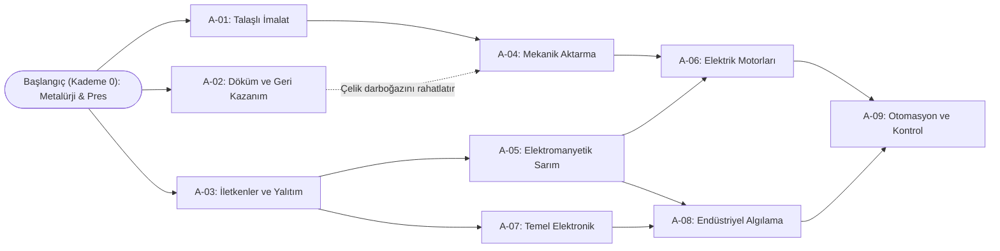

# Teknoloji ağacı

## İlk taslak: 24 ürüne bağlı 9 araştırmalık teknoloji ağacı (K-007)

[[Tasarım/Ürün ve Üretim Ağı|24 ürünlük üretim ağı]] ile birlikte çalışan, tek koridor olmayan (3 paralel koldan başlayıp kesişen) ve eski üretim hatlarını boşa çıkarmayan **9 araştırmalık ilk taslak** kaydedilmiştir ([[Yönetim/Karar Defteri#K-007 — 24 ürünlük üretim ağı ve 9 araştırmalık teknoloji ağacı ilk taslağı|K-007]]).

> [!note] İlk taslak sınırları
> - Her araştırmanın tükettiği ürün türleri ve açtığı makine/reçeteler ilk taslak olarak belirlenmiştir.
> - Deney sayıları, deney başına ürün miktarları ve deney süreleri henüz sabitlenmemiştir.
> - Montaj makinelerinin 3 ayrı tür (`Montaj İstasyonu`, `Elektronik Montaj`, `Hassas Montaj`) veya tek `Montaj İstasyonu` olması açıktır.

---

### Başlangıç durumu (Kademe 0 — Oyuna başlarken açık olanlar)

Hiçbir araştırmanın kilitlenmemesi (deadlock oluşmaması) için oyuncu temel metalürji ve kaba şekillendirme ile başlar:

- **Açık Hammaddeler (4):** `1. Demir Cevheri`, `2. Bakır Cevheri`, `3. Kömür`, `4. Kuvars`
- **Açık Makineler (4):** `Ergitme Fırını`, `Çelik Fırını`, `Haddehane`, `Pres`
- **Başlangıçta Üretilebilen Ürünler (7):**
  - `5. Pik Demir` (Demir Cevheri + Kömür → Ergitme Fırını)
  - `6. Çelik Külçe` (Pik Demir + Kömür → Çelik Fırını)
  - `7. Bakır Külçe` (Bakır Cevheri → Ergitme Fırını)
  - `8. Çelik Levha` (Çelik Külçe → Haddehane)
  - `9. Çelik Çubuk` (Çelik Külçe → Haddehane)
  - `11. Bağlantı Elemanları` (Çelik Çubuk → Pres)
  - `17. Gövde — Pres Yöntemi` (Çelik Levha + Bağlantı Elemanı → Pres)

---

### Teknoloji ağacı akış şeması

> [!info] Prototipteki karşılığı (ilk deneme)
> - Başlangıçta açık makineler aşağıdaki dörde ek olarak dört maden (birer adet, K-010), `Talaş bertaraf ünitesi`, `Laboratuvar 1` ve `Depo`dur.
> - Araştırmalar laboratuvar da açar: A-03 → `Laboratuvar 2`, A-07 → `Laboratuvar 3`. A-09 `Ana proje terminali`ni açar.
> - Açılan makineler kendiliğinden gelmez; oyuncu onları malzemeyle üretir (K-011).
> - Üç montaj türü tek `Montaj istasyonu` altında birleşiktir.

> [!warning] Tükettiği ürünler sütunu tarihseldir
> Aşağıdaki tablolardaki "Tükettiği Ürünler" sütunu K-001 dönemine aittir. K-008 ile araştırmalar ürün değil kademe puanı ister; güncel fiyatlar ve laboratuvarlar [[Tasarım/Araştırma Ekonomisi]] notundadır.

---

### 1. Kademe: Üç bağımsız kol (İstenen sırada açılabilir)

| Kod | Araştırma Adı | Ön Koşul | Tükettiği Ürünler (K-001) | Açtığı Makine | Açtığı Ürün ve Reçeteler |
|---|---|---|---|---|---|
| **A-01** | **Talaşlı İmalat** | Başlangıç | `8. Çelik Levha` `9. Çelik Çubuk` `11. Bağlantı Elemanları` | `Torna`, `CNC` | `12. Mil` (Torna) `13. Dişli — CNC Yöntemi` (CNC) `14. Rulman` (CNC) `16. Metal Talaşı` *(yan ürün olarak çıkar)* |
| **A-02** | **Döküm ve Geri Kazanım** | Başlangıç | `5. Pik Demir` `6. Çelik Külçe` `8. Çelik Levha` | `Dökümhane` | `13. Dişli — Döküm Yöntemi` (Pik Demir) `17. Gövde — Döküm Yöntemi` (Pik Demir) `16. Metal Talaşı → 6. Çelik Külçe` *(Geri kazanım reçetesi)* |
| **A-03** | **İletkenler ve Yalıtım** | Başlangıç | `7. Bakır Külçe` `8. Çelik Levha` `11. Bağlantı Elemanları` | `Tel Çekme / Sarım Makinesi` | `15. Bakır Tel` (Tel Çekme) `10. Endüstriyel Cam / Yalıtkan` (Fırın) |

> [!tip] Tasarım Notu — A-02'nin Rolü
> Oyuncu **A-01**'i açtığında `Bağlantı Elemanı`, `Mil`, `Dişli` ve `Rulman` aynı anda `Çelik Çubuk` için yarışmaya başlar; ayrıca `Torna` ve `CNC`'den `Metal Talaşı` birikir. Oyuncu **A-02**'yi araştırdığında hem talaşı tekrar `Çelik Külçe`'ye dönüştürür hem de `Dişli` ve `Gövde` üretimini `Pik Demir` (`Dökümhane`) hattına kaydırarak çelik darboğazını çözer.

---

### 2. Kademe: Mekanik, elektromekanik ve elektronik alt sistemler

| Kod | Araştırma Adı | Ön Koşul | Tükettiği Ürünler (K-001) | Açtığı Makine | Açtığı Ürün ve Reçeteler |
|---|---|---|---|---|---|
| **A-04** | **Mekanik Aktarma Sistemleri** | A-01 | `12. Mil` `13. Dişli` `14. Rulman` `17. Gövde` | `Montaj İstasyonu` | `19. Dişli Kutusu (Redüktör)` |
| **A-05** | **Elektromanyetik Sarım** | A-03 | `15. Bakır Tel` `9. Çelik Çubuk` `10. Endüstriyel Cam / Yalıtkan` | *(Sarım reçetesi)* | `18. Elektromanyetik Bobin` |
| **A-06** | **Elektrik Motorları** | A-04, A-05 | `18. Elektromanyetik Bobin` `12. Mil` `14. Rulman` `17. Gövde` | *(Montaj reçetesi)* | `21. Elektrik Motoru` |
| **A-07** | **Temel Elektronik** | A-03 | `15. Bakır Tel` `10. Endüstriyel Cam / Yalıtkan` `11. Bağlantı Elemanları` | `Elektronik Montaj` *(veya Montaj İstasyonu)* | `20. Devre Kartı` |

> [!tip] Tasarım Notu — K-006 Ortak Paylaşım Testi
> Hem **A-04 (Dişli Kutusu)** hem **A-06 (Elektrik Motoru)** aynı `Mil`, `Rulman` ve `Gövde` hatlarını paylaşır. Benzer şekilde **A-05 (Bobin)** ve **A-07 (Devre Kartı)** aynı `Bakır Tel` ve `Endüstriyel Cam / Yalıtkan` hatlarını paylaşır.

---

### 3. Kademe: Algılama, otomasyon ve ileri sistemler

| Kod | Araştırma Adı | Ön Koşul | Tükettiği Ürünler (K-001) | Açtığı Makine | Açtığı Ürün ve Reçeteler |
|---|---|---|---|---|---|
| **A-08** | **Endüstriyel Algılama** | A-05, A-07 | `20. Devre Kartı` `18. Elektromanyetik Bobin` `10. Endüstriyel Cam / Yalıtkan` | `Hassas Montaj` *(veya Montaj İstasyonu)* | `22. Endüstriyel Sensör` |
| **A-09** | **Otomasyon ve Kontrol Sistemleri** | A-06, A-08 | `19. Dişli Kutusu` `21. Elektrik Motoru` `22. Endüstriyel Sensör` `20. Devre Kartı` | *(İleri Montaj reçeteleri)* | `23. Hassas Aktüatör (Servo Kolu)` `24. Kontrol Ünitesi (PLC)` |

**A-09 Sonrası Tüketim:** `23. Hassas Aktüatör` ve `24. Kontrol Ünitesi` (diğer alt sistemlerle birlikte) **Ana Proje aşamalarını** ve **yüksek kapasiteli fabrika genişlemesini** besleyen uç ürünler olur.

---

## Genel yapı ilkeleri ve tarihsel bağlam

### Ödül türleri
1. **Yeni yetenek:** Yeni makine veya daha önce üretilemeyen ürün (`Torna`, `CNC`, `Montaj İstasyonu`).
2. **Mevcut üretimin gelişimi:** Alternatif yöntem, kapasite artışı veya kaynak tasarrufu (`A-02: Döküm ve Geri Kazanım`).
3. **Ağ yönetimi:** İleride eklenebilecek dağıtıcı, filtre veya kapasite kontrol araçları.

### Kilitlenmeyi (Deadlock) önleme kontrolü
Bir araştırma yalnızca kendisinin açacağı teknolojiyle üretilebilen ürünü isteyemez. Yukarıdaki `A-01` – `A-09` ağında her araştırma, yalnızca Kademe 0 veya kendi ön koşul araştırmalarının açtığı ürünlerle beslenir; doğrudan veya dolaylı erişilemeyen döngü bulunmaz.

### Oyuncuya gösterim önerisi
Gelecek ürünlerin nerede kullanılacağı önceden görülebilmeli. Kilitli teknoloji hangi ön koşul, üretim kabiliyeti veya malzeme nedeniyle erişilemez olduğunu açıklamalı. Alternatif yolların avantajları anlaşılabilir olmalı.

Bağlantılar: [[Tasarım/Ürün ve Üretim Ağı]], [[Tasarım/Araştırma Ekonomisi]], [[Tasarım/Prosesler Kalite ve Yan Ürünler]], [[Tasarım/Simülasyon İlkeleri]].
