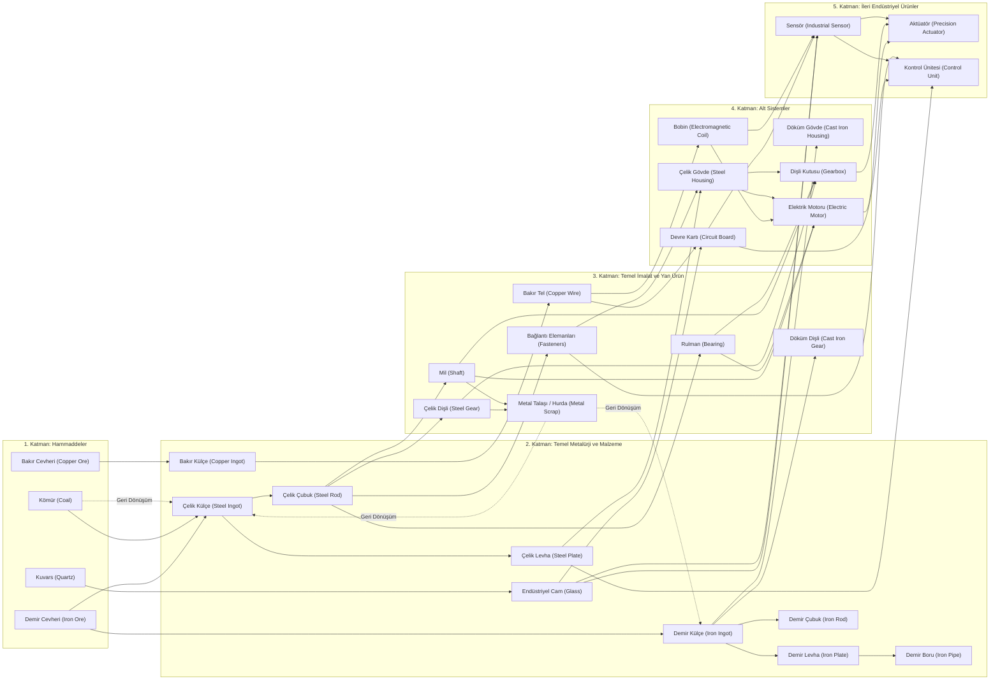

# Ürün ve üretim ağı (İlk taslak — K-007, K-017)

## Kapsam ve tasarım amacı

Bu not, oyunun üretim ağını, ürün ilişkilerini ve makine türlerini tanımlar ([[Yönetim/Karar Defteri#K-007 — 24 ürünlük üretim ağı ve 9 araştırmalık teknoloji ağacı ilk taslağı|K-007]], [[Yönetim/Karar Defteri#K-017 — Tek reçete ve farklı ürün ilkesi|K-017]]).

Tasarımda temel ilkeler:
- **Tek reçete ilkesi (K-017):** Her ürünün tam olarak **tek bir ana üretim tarifi** vardır. Makinelerin aynı ürün için alternatif tariflerle karmaşıklaşması engellenir.
- **Farklı yöntem = Farklı ürün (K-017):** Döküm ve talaşlı imalat gibi farklı üretim yöntemleri ya da demir ve çelik gibi farklı hammadde aileleri aynı ürünü çıkarmaz; ayrı ürünler üretir (Örn: `Cast Iron Gear` vs `Steel Gear`; `Cast Iron Housing` vs `Steel Housing`).
- **Ortak ara ürünler ve paylaşım:** Ortak ara girdiler üzerinden araştırma, alt sistemler ve fabrika genişlemesi arasında paylaşım kararları ([[Tasarım/Ana Proje ve Ürün Dağıtımı#Onaylı otomatik eşit paylaşım — K-006|K-006]]) doğması hedeflenir.
- **Yan ürün geri kazanımı:** `Metal Talaşı / Hurda (Metal Scrap)` geri dönüşümle ergitmeye ve çelik fırınına dönerek hammadde tasarrufu sağlar.

> [!note] Tasarım ve prototip sınırları
> - **Kalite sistemi (A/B/C):** Kullanıcı kararıyla şu aşamada kapsam dışı bırakılmıştır; ürünler tek standart kalitede üretilir.
> - **Demir ve Çelik ayrımı:** Demir Külçe (`Iron Ingot`) kömürsüz fırında (`2x Iron Ore -> 2x Iron Ingot`), Çelik Külçe (`Steel Ingot`) ise kömür katkısıyla (`2x Iron Ore + 1x Coal -> 2x Steel Ingot`) üretilir.
> - **Demir ara mamulleri:** `Iron Ingot`tan `Iron Plate` ve `Iron Rod`; `Iron Plate`ten `Iron Pipe` üretilir.
> - **Montaj makineleri:** `Montaj İstasyonu`, `Elektronik Montaj` ve `Hassas Montaj` ayrı makine kartları olarak veya birleşik olarak uygulanabilir; bu ayrım açıktır.
> - **Prototip:** Sayısal reçeteler `data/prototype.json` içinde tutulur ve görsel ürün zinciri editörü (`app/chain_editor.tscn`) üzerinden incelenebilir.

---

## Üretim ağı akış şeması

---

## Katalog ve Katmanlar (K-017 Uyarlaması)

### 1. Katman: Hammaddeler
| Ürün | Kaynak | Tüketildiği Yer |
|---|---|---|
| **Iron Ore (Demir Cevheri)** | Demir Madeni | `Iron Ingot`, `Steel Ingot` |
| **Copper Ore (Bakır Cevheri)** | Bakır Madeni | `Copper Ingot` |
| **Coal (Kömür)** | Kömür Madeni | `Steel Ingot` (karbon katkısı), Hurda Çelik geri dönüşümü |
| **Quartz (Kuvars)** | Taş / Kuvars Ocağı | `Industrial Glass` |

### 2. Katman: Metalürji ve Malzeme
| Ürün | Girdiler | Makine | Kullanım Alanı |
|---|---|---|---|
| **Iron Ingot (Demir Külçe)** | 2x Iron Ore | Ergitme Fırını | `Iron Plate`, `Iron Rod`, `Cast Iron Gear`, `Cast Iron Housing` |
| **Steel Ingot (Çelik Külçe)** | 2x Iron Ore + 1x Coal | Çelik Fırını | `Steel Plate`, `Steel Rod` |
| **Copper Ingot (Bakır Külçe)** | 2x Copper Ore | Ergitme Fırını | `Copper Wire` |
| **Industrial Glass (Endüstriyel Cam)** | 2x Quartz | Ergitme Fırını | `Circuit Board`, `Industrial Sensor` |
| **Iron Plate (Demir Levha)** | 1x Iron Ingot | Haddehane | `Iron Pipe`, inşaat / altyapı |
| **Iron Rod (Demir Çubuk)** | 1x Iron Ingot (çıktı: 2) | Haddehane | İnşaat, temel mekanik parçalar |
| **Iron Pipe (Demir Boru)** | 1x Iron Plate | Haddehane / Pres | Sıvı/gaz transferi, altyapı |
| **Steel Plate (Çelik Levha)** | 1x Steel Ingot | Haddehane | `Steel Housing`, `Control Unit`, makine kurulumları |
| **Steel Rod (Çelik Çubuk)** | 1x Steel Ingot | Haddehane | `Fasteners`, `Shaft`, `Steel Gear`, `Bearing`, `Electromagnetic Coil` |

### 3. Katman: Temel İmalat ve Yan Ürün
| Ürün | Girdiler | Makine | Not / Tek Reçete |
|---|---|---|---|
| **Fasteners (Bağlantı Elemanları)** | 1x Steel Rod (çıktı: 2) | Pres | `Steel Housing`, `Control Unit`, makine kurulumları |
| **Shaft (Mil)** | 1x Steel Rod (çıktı: 1x Shaft + 1x Metal Scrap) | Torna | `Gearbox`, `Electric Motor` |
| **Steel Gear (Çelik Dişli)** | 1x Steel Rod (çıktı: 1x Steel Gear + 1x Metal Scrap) | CNC | Yüksek mukavemetli `Gearbox` montajı |
| **Cast Iron Gear (Döküm Dişli)** | 1x Iron Ingot | Dökümhane | Döküm mekanik aksamlar |
| **Bearing (Rulman)** | 1x Steel Rod (çıktı: 1x Bearing + 1x Metal Scrap) | CNC | `Gearbox`, `Electric Motor` |
| **Copper Wire (Bakır Tel)** | 1x Copper Ingot (çıktı: 2) | Tel Çekme / Sarım | `Electromagnetic Coil`, `Circuit Board` |
| **Metal Scrap (Metal Talaşı / Hurda)** | Torna & CNC talaşı | Fırınlar (Geri Dönüşüm) | Ergitme Fırını (`2x Scrap -> 1x Iron Ingot`) veya Çelik Fırını (`2x Scrap + 1x Coal -> 1x Steel Ingot`) |

### 4. Katman: Alt Sistemler
| Ürün | Girdiler | Makine | Not |
|---|---|---|---|
| **Steel Housing (Çelik Gövde)** | 2x Steel Plate + 2x Fasteners | Pres | Presleme montaj gövdesi |
| **Cast Iron Housing (Döküm Gövde)** | 2x Iron Ingot | Dökümhane | Döküm ağır gövde |
| **Electromagnetic Coil (Bobin)** | 2x Copper Wire + 1x Steel Rod | Tel Çekme / Sarım | `Electric Motor`, `Industrial Sensor` |
| **Gearbox (Dişli Kutusu / Redüktör)** | 2x Gear + 1x Shaft + 2x Bearing + 1x Housing | Montaj İstasyonu | Mekanik aktarım alt sistemi |
| **Circuit Board (Devre Kartı)** | 2x Copper Wire + 1x Industrial Glass | Elektronik Montaj | `Industrial Sensor`, `Control Unit` |
| **Electric Motor (Elektrik Motoru)** | 2x Coil + 1x Shaft + 2x Bearing + 1x Housing | Montaj İstasyonu | Elektromekanik güç ünitesi |

### 5. Katman: İleri Endüstriyel Ürünler
| Ürün | Girdiler | Makine | Rolü |
|---|---|---|---|
| **Industrial Sensor (Endüstriyel Sensör)** | 1x Circuit Board + 1x Coil + 1x Industrial Glass | Hassas Montaj | `Precision Actuator`, `Control Unit` |
| **Precision Actuator (Hassas Aktüatör)** | 1x Electric Motor + 1x Gearbox + 1x Industrial Sensor | Hassas Montaj | Ana Proje hedefleri, robotik genişleme |
| **Control Unit (PLC / Kontrol Ünitesi)** | 1x Circuit Board + 1x Industrial Sensor + 1x Steel Plate + 2x Fasteners | Elektronik Montaj | Ana Proje hedefleri, otomasyon yönetimi |

---

## Tasarım Kesişimleri ve K-017 Stratejik Etkileri

1. **Reçete Başına Tek Çıktı ve Netlik:**
   - Her ürünün tek bir tarifinin olması, oyuncunun makine kartını kurarken veya otomasyon kurarken kafa karışıklığı yaşamasını engeller.
   - Dökümhane döküm parçaları (`Cast Iron Gear`, `Cast Iron Housing`), CNC ve Torna ise çelik talaşlı parçaları üretir.
2. **Hammadde Seçimi ve Hat Yönetimi:**
   - Oyuncu demir bazlı daha ucuz/hızlı döküm hattı ile çelik bazlı hassas/mukavim talaşlı imalat hattı arasında tercih yapar.
   - Demir hattı (Levha, Çubuk, Boru) altyapı ve kaba montajlar için ana besleme kolu haline gelirken, çelik hattı hassas mekanik parçalar için kullanılır.
3. **Geri Dönüşüm Dengesi:**
   - Talaşlı imalattan çıkan `Metal Scrap`, kömür harcamadan `Iron Ingot`a veya kömür eklenerek `Steel Ingot`a geri dönüştürülebilir.

İlgili notlar: [[Tasarım/Teknoloji Ağacı]], [[Tasarım/Makine Kartları]], [[Tasarım/Prosesler Kalite ve Yan Ürünler]], [[Tasarım/Ana Proje ve Ürün Dağıtımı]].
