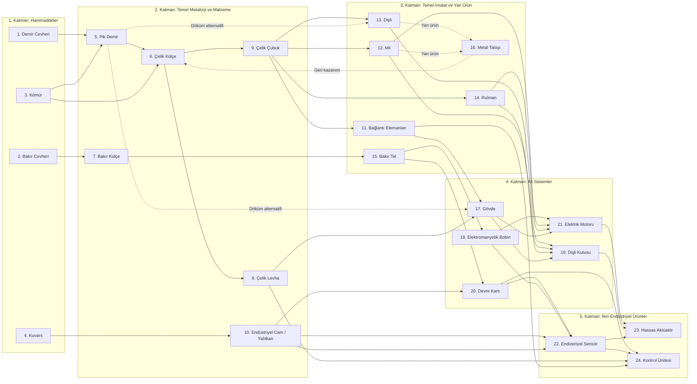

# Ürün ve üretim ağı (İlk taslak — K-007)

## Kapsam ve tasarım amacı

Bu not, oyunun ilk taslak olarak kararlaştırılan **24 ürünlük üretim ağını** ve ilgili **makine türlerini** tanımlar ([[Yönetim/Karar Defteri#K-007 — 24 ürünlük üretim ağı ve 9 araştırmalık teknoloji ağacı ilk taslağı|K-007]]).

Tasarımda her ürünün tek bir yerde kullanılıp unutulması yerine:
- **Ortak ara ürünler** üzerinden araştırma, alt sistemler ve genişleme arasında paylaşım kararları ([[Tasarım/Ana Proje ve Ürün Dağıtımı#Onaylı otomatik eşit paylaşım — K-006|K-006]]) doğurması,
- **Alternatif üretim yöntemlerine** (talaşlı imalat vs. döküm/pres) zemin hazırlaması,
- **Yan ürün geri kazanımı** (`Metal Talaşı`) ile hammadde tasarrufu seçeneği sunması hedeflenmiştir.

> [!note] İlk taslak sınırları
> - **Kalite sistemi (A/B/C):** Kullanıcı kararıyla şu aşamada kapsam dışı bırakılmıştır; ürünler tek standart kalitede üretilir.
> - **Sayısal değerler:** Reçetelerin girdi/çıktı adetleri, gereken iş miktarları ([[Tasarım/Makine Kartları#Onaylı üretim modeli — K-005|K-005]]) ve makine işleme hızları henüz sabitlenmemiştir.
> - **Montaj makineleri:** `Montaj İstasyonu`, `Elektronik Montaj` ve `Hassas Montaj` ayrı makine kartları olarak veya tek `Montaj İstasyonu` altında birleştirilerek uygulanabilir; bu ayrım açıktır.

---

## Üretim ağı akış şeması

---

## 24 ürünlük katalog (5 katman)

### 1. Katman: Hammaddeler (4 Ürün)
| # | Ürün | Kaynak / Çıkarım | Nerelerde Kullanılır? |
|---|---|---|---|
| 1 | **Demir Cevheri** | Demir Madeni | `5. Pik Demir` |
| 2 | **Bakır Cevheri** | Bakır Madeni | `7. Bakır Külçe` |
| 3 | **Kömür** | Kömür Madeni | `5. Pik Demir`, `6. Çelik Külçe` (ergitme ve karbon katkısı) |
| 4 | **Kuvars / Silika** | Taş / Kuvars Ocağı | `10. Endüstriyel Cam / Yalıtkan` |

### 2. Katman: Temel Metalürji ve Malzeme (6 Ürün)
| # | Ürün | Girdiler | Makine Türü | Nerelerde Kullanılır? |
|---|---|---|---|---|
| 5 | **Pik Demir (Ham Demir)** | Demir Cevheri + Kömür | Ergitme Fırını | `6. Çelik Külçe`, `13. Dişli (Döküm)`, `17. Gövde (Döküm)`, Araştırma (A-02) |
| 6 | **Çelik Külçe** | **Yöntem A:** Pik Demir + Kömür **Yöntem B (Geri kazanım):** Metal Talaşı (+ Pik Demir/Kömür) | Çelik Fırını | `8. Çelik Levha`, `9. Çelik Çubuk`, Araştırma (A-02) |
| 7 | **Bakır Külçe** | Bakır Cevheri | Ergitme Fırını | `15. Bakır Tel`, Araştırma (A-03) |
| 8 | **Çelik Levha** | Çelik Külçe | Haddehane | `17. Gövde (Pres)`, `24. Kontrol Ünitesi`, Araştırma (A-01, A-02, A-03) |
| 9 | **Çelik Çubuk** | Çelik Külçe | Haddehane | `11. Bağlantı Elemanları`, `12. Mil`, `13. Dişli (CNC)`, `14. Rulman`, `18. Bobin`, Araştırma (A-01, A-05) |
| 10 | **Endüstriyel Cam / Yalıtkan** | Kuvars | Ergitme Fırını / Fırın | `20. Devre Kartı`, `22. Endüstriyel Sensör`, Araştırma (A-05, A-07, A-08) |

### 3. Katman: Temel İmalat ve Yan Ürün (6 Ürün)
| # | Ürün | Girdiler ve Alternatif Yöntemler | Makine Türü | Nerelerde Kullanılır? |
|---|---|---|---|---|
| 11 | **Bağlantı Elemanları (Vida/Civata)** | Çelik Çubuk | Pres | `17. Gövde (Pres)`, `24. Kontrol Ünitesi`, Araştırma (A-01, A-03, A-07) |
| 12 | **Mil (Şaft)** | Çelik Çubuk → Mil + *Metal Talaşı* | Torna | `19. Dişli Kutusu`, `21. Elektrik Motoru`, Araştırma (A-04, A-06) |
| 13 | **Dişli** | **Yöntem A (Talaşlı):** Çelik Çubuk → Dişli + *Metal Talaşı* **Yöntem B (Döküm):** Pik Demir → Dişli | CNC *(A)* veya Dökümhane *(B)* | `19. Dişli Kutusu`, Araştırma (A-04) |
| 14 | **Rulman** | Çelik Çubuk → Rulman (+ *Metal Talaşı*) | CNC | `19. Dişli Kutusu`, `21. Elektrik Motoru`, Araştırma (A-04, A-06) |
| 15 | **Bakır Tel** | Bakır Külçe | Tel Çekme / Sarım Makinesi | `18. Elektromanyetik Bobin`, `20. Devre Kartı`, Araştırma (A-05, A-07) |
| 16 | **Metal Talaşı (Yan Ürün)** | *Torna ve CNC işlemlerinden yan ürün olarak çıkar* | Çelik Fırını *(geri kazanım)* | `6. Çelik Külçe` üretimine geri beslenir |

### 4. Katman: Alt Sistemler — Mekanik ve Elektromekanik (5 Ürün)
| # | Ürün | Girdiler ve Alternatif Yöntemler | Makine Türü | Nerelerde Kullanılır? |
|---|---|---|---|---|
| 17 | **Gövde (Makine/Motor Gövdesi)** | **Yöntem A (Pres):** Çelik Levha + Bağlantı Elemanı **Yöntem B (Döküm):** Pik Demir | Pres *(A)* veya Dökümhane *(B)* | `19. Dişli Kutusu`, `21. Elektrik Motoru`, Araştırma (A-04, A-06) |
| 18 | **Elektromanyetik Bobin** | Bakır Tel + Çelik Çubuk | Tel Çekme / Sarım Makinesi | `21. Elektrik Motoru`, `22. Endüstriyel Sensör`, Araştırma (A-06, A-08) |
| 19 | **Dişli Kutusu (Redüktör)** | Dişli + Mil + Rulman + Gövde | Montaj İstasyonu | `23. Hassas Aktüatör`, Araştırma (A-09), Makine kurulumu |
| 20 | **Devre Kartı** | Bakır Tel + Endüstriyel Cam / Yalıtkan | Elektronik Montaj *(veya Montaj İstasyonu)* | `22. Endüstriyel Sensör`, `24. Kontrol Ünitesi`, Araştırma (A-08, A-09) |
| 21 | **Elektrik Motoru** | Elektromanyetik Bobin + Mil + Rulman + Gövde | Montaj İstasyonu | `23. Hassas Aktüatör`, Araştırma (A-09), Makine kurulumu |

### 5. Katman: İleri Endüstriyel Ürünler / Tüketim Hedefleri (3 Ürün)
| # | Ürün | Girdiler | Makine Türü | Rolü (Araştırma / Genişleme / Ana Proje) |
|---|---|---|---|---|
| 22 | **Endüstriyel Sensör** | Devre Kartı + Elektromanyetik Bobin + Endüstriyel Cam / Yalıtkan | Hassas Montaj *(veya Montaj İstasyonu)* | `23. Hassas Aktüatör`, `24. Kontrol Ünitesi`, Araştırma (A-09) |
| 23 | **Hassas Aktüatör (Servo Kolu)** | Elektrik Motoru + Dişli Kutusu + Endüstriyel Sensör | Hassas Montaj *(veya Montaj İstasyonu)* | Ana Proje aşamaları, ileri fabrika genişlemesi |
| 24 | **Kontrol Ünitesi (PLC)** | Devre Kartı + Endüstriyel Sensör + Çelik Levha + Bağlantı Elemanları | Elektronik Montaj *(veya Montaj İstasyonu)* | Ana Proje aşamaları, ileri fabrika genişlemesi |

---

## Makine türleri özeti (İlk taslak)

| Makine Türü | Çalıştırdığı Başlıca Reçeteler | Açıldığı Aşama |
|---|---|---|
| **Ergitme Fırını** | `5. Pik Demir`, `7. Bakır Külçe`, `10. Endüstriyel Cam / Yalıtkan` | Başlangıç (`10` reçetesi A-03 ile) |
| **Çelik Fırını** | `6. Çelik Külçe` (Pik Demir + Kömür veya `16. Metal Talaşı` geri kazanımı) | Başlangıç (Talaş geri kazanımı A-02 ile) |
| **Haddehane** | `8. Çelik Levha`, `9. Çelik Çubuk` | Başlangıç |
| **Pres** | `11. Bağlantı Elemanları`, `17. Gövde (Pres yöntemi)` | Başlangıç |
| **Torna** | `12. Mil` (+ `16. Metal Talaşı`) | A-01: Talaşlı İmalat |
| **CNC** | `13. Dişli (CNC yöntemi)`, `14. Rulman` (+ `16. Metal Talaşı`) | A-01: Talaşlı İmalat |
| **Dökümhane** | `13. Dişli (Döküm yöntemi)`, `17. Gövde (Döküm yöntemi)` | A-02: Döküm ve Geri Kazanım |
| **Tel Çekme / Sarım Makinesi** | `15. Bakır Tel`, `18. Elektromanyetik Bobin` | A-03 (Tel) ve A-05 (Bobin) |
| **Montaj İstasyonu** *(veya 3 alt montaj türü)* | `19. Dişli Kutusu`, `20. Devre Kartı`, `21. Elektrik Motoru`, `22. Sensör`, `23. Aktüatör`, `24. Kontrol Ünitesi` | A-04, A-07, A-08, A-09 |

---

## Tasarım kesişimleri ve stratejik karar noktaları

1. **Ortak ara ürün darboğazları (K-006 paylaşım testi):**
   - `9. Çelik Çubuk`; `Bağlantı Elemanı`, `Mil`, `Dişli`, `Rulman` ve `Bobin` hatları arasında paylaşılır.
   - `12. Mil`, `14. Rulman` ve `17. Gövde`; hem `19. Dişli Kutusu` hem `21. Elektrik Motoru` tarafından aynı anda talep edilir.
   - `15. Bakır Tel` ve `10. Endüstriyel Cam / Yalıtkan`; hem elektromekanik (`Bobin`) hem elektronik (`Devre Kartı`, `Sensör`) kollarını besler.
2. **Alternatif proseslerle darboğaz çözme:**
   - Oyuncu `Dişli` ve `Gövde` üretimini çelikten (`Çelik Çubuk` / `Çelik Levha`) **Dökümhane** (`Pik Demir`) hattına kaydırarak çelik haddeleme kapasitesini `Mil` ve `Rulman` için serbest bırakabilir.
3. **Yan ürün döngüsü:**
   - `Torna` ve `CNC` çalıştıkça çıkan `16. Metal Talaşı`, `Çelik Fırını`na geri beslenerek cevher ve pik demir ihtiyacını azaltır.

İlgili notlar: [[Tasarım/Teknoloji Ağacı]], [[Tasarım/Makine Kartları]], [[Tasarım/Prosesler Kalite ve Yan Ürünler]], [[Tasarım/Ana Proje ve Ürün Dağıtımı]].
