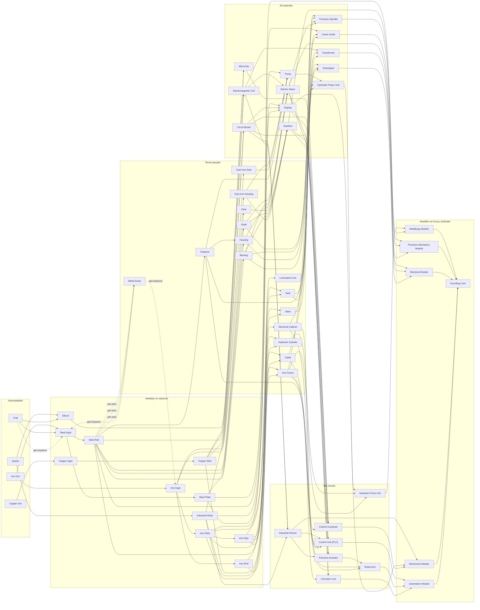

# Ürün ve üretim ağı (K-007, K-017, K-018 – K-021)

## Kapsam

Bu not, Kurucu Çekirdek'e giden üretim ağını tanımlar. Ağın amacı ana proje kararıyla belirlenir ([[Yönetim/Karar Defteri#K-018 — Ana proje: Son Fabrika ve Kurucu Çekirdek|K-018]]): her ürün sonunda bir modüle, laboratuvara ya da makine kurulumuna gider. Tarifler [[Yönetim/Karar Defteri#K-021 — Beş modülün reçete taslağı|K-021]] ile adım adım onaylandı.

İlkeler:
- **Tek reçete (K-017):** Her ürünün tek tarifi vardır; farklı yöntem ya da malzeme farklı ürün demektir (`Cast Iron Gear` ve `Gear`, `Cast Iron Housing` ve `Housing`). Hurdadan geri kazanım bunun dışındadır.
- **Sondan başa tasarım:** Tarifler “bundan ne yapılır” diye değil, modülün neye ihtiyacı olduğundan geriye doğru kuruldu. Tüketicisi olmayan ürün eklenmez.
- **Kollar birbirine bağlı (K-019):** Bazı reçeteler iki ayrı koldan malzeme ister. Uygulamada kademe 4 ve üstündeki montajlar en az iki koldan beslenir; bu ölçüt asistan önerisidir.
- **Zorluk tepededir (K-018):** Alt tarifler küçük adetlidir; büyük adetler modül ve çekirdek tariflerinde istenir. Final proje oyuncuyu fabrikayı genişletmeye zorlar.
- **Ürün sayısı sınırı yok** (kullanıcı: “30 40 ı boş ver”).
- **Kalite (A/B/C)** kapsam dışıdır.

> [!note] Sayılar ilk tahmindir
> Bütün adetler, iş miktarları ve modül/çekirdek adetleri denenmemiş ilk değerlerdir. Makine ve araştırma atamaları asistan seçimidir; makineler ayrıca ele alınacak ([[Yönetim/Karar Defteri#K-020 — Makine üreten makineler|K-020]]). Veri `data/prototype.json` dosyasındadır ve Zincir Editörü (`ZincirEditoru.cmd`) ile görsel olarak düzenlenebilir.

## Kurucu Çekirdek

`Founding Core` = 4 `Metallurgy Module` + 4 `Precision Mechanics Module` + 4 `Electrical Module` + 4 `Electronics Module` + 4 `Automation Module`. Ana proje terminali 1 `Founding Core` ister.

| Modül | Tarif | Ana kollar |
|---|---|---|
| `Metallurgy Module` (Metalürji modülü) | 8 `Hydraulic Press Unit` + 50 `Steel Plate` | Demir, çelik |
| `Precision Mechanics Module` (Hassas mekanik modülü) | 6 `Gearbox` + 4 `Precision Spindle` + 6 `Linear Guide` | Çelik, demir, bakır |
| `Electrical Module` (Elektrik modülü) | 6 `Electric Motor` + 4 `Transformer` + 4 `Switchgear` | Bakır, demir, çelik, kuvars |
| `Electronics Module` (Elektronik modülü) | 6 `Industrial Sensor` + 4 `Display` + 4 `Control Computer` | Kuvars, bakır, kömür, demir, çelik |
| `Automation Module` (Otomasyon modülü) | 6 `Control Unit (PLC)` + 4 `Robot Arm` + 4 `Conveyor Line` | Hepsi |

Kimya modülü yeni hammaddelerle ileride eklenecek.

## Akış şeması

## Ürün kataloğu

Tablolar `data/prototype.json` ile aynıdır.

### Hammaddeler

| Ürün | Tarif | Makine | Kullanıldığı yer |
|---|---|---|---|
| `Iron Ore` (Demir cevheri) | Maden | Demir madeni | `Iron Ingot`, `Steel Ingot` |
| `Copper Ore` (Bakır cevheri) | Maden | Bakır madeni | `Copper Ingot` |
| `Coal` (Kömür) | Maden | Kömür madeni | `Silicon`, `Steel Ingot` |
| `Quartz` (Kuvars) | Maden | Kuvars ocağı | `Silicon`, `Industrial Glass` |

### Metalürji ve malzeme

| Ürün | Tarif | Makine | Kullanıldığı yer |
|---|---|---|---|
| `Iron Ingot` (Demir külçe) | 2 `Iron Ore` → 2 `Iron Ingot` 2 `Metal Scrap` → 1 `Iron Ingot` | Ergitme fırını | `Iron Plate`, `Iron Rod`, `Cast Iron Gear`, `Cast Iron Housing` |
| `Steel Ingot` (Çelik külçe) | 2 `Iron Ore` + 1 `Coal` → 2 `Steel Ingot` 2 `Metal Scrap` + 1 `Coal` → 1 `Steel Ingot` | Çelik fırını | `Steel Plate`, `Steel Rod`, kurulum: Ergitme fırını, Çelik fırını, Dökümhane |
| `Copper Ingot` (Bakır külçe) | 2 `Copper Ore` → 2 `Copper Ingot` | Ergitme fırını | `Copper Wire` |
| `Industrial Glass` (Endüstriyel cam) | 2 `Quartz` → 1 `Industrial Glass` | Ergitme fırını | `Cable`, `Display`, `Circuit Board`, `Industrial Sensor`, Laboratuvar (K2) |
| `Silicon` (Silisyum) | 2 `Quartz` + 1 `Coal` → 1 `Silicon` | Ergitme fırını | `Microchip` |
| `Iron Plate` (Demir levha) | 1 `Iron Ingot` → 1 `Iron Plate` | Haddehane | `Iron Pipe`, `Electrical Cabinet`, `Tank`, `Iron Frame`, `Laminated Core` |
| `Iron Rod` (Demir çubuk) | 1 `Iron Ingot` → 2 `Iron Rod` | Haddehane | `Valve`, `Iron Frame` |
| `Iron Pipe` (Demir boru) | 1 `Iron Plate` → 1 `Iron Pipe` | Haddehane | `Valve`, `Tank`, `Hydraulic Cylinder`, `Pump` |
| `Steel Plate` (Çelik levha) | 1 `Steel Ingot` → 1 `Steel Plate` | Haddehane | `Metallurgy Module`, `Display`, `Housing`, Laboratuvar (K1), kurulum: Demir madeni, Bakır madeni, Kömür madeni, Kuvars ocağı, Ergitme fırını, Çelik fırını, Haddehane, Pres, Torna, CNC, Dökümhane, Tel sarım, Montaj istasyonu, Talaş imha, Depo, Laboratuvar 1, Laboratuvar 2, Laboratuvar 3, Ana proje terminali |
| `Steel Rod` (Çelik çubuk) | 1 `Steel Ingot` → 2 `Steel Rod` | Haddehane | `Hydraulic Cylinder`, `Linear Guide`, `Fastener`, `Shaft`, `Gear`, `Bearing`, `Electromagnetic Coil`, kurulum: Torna, CNC |
| `Copper Wire` (Bakır tel) | 1 `Copper Ingot` → 2 `Copper Wire` | Tel sarım | `Cable`, `Microchip`, `Electromagnetic Coil`, `Circuit Board`, Laboratuvar (K2), kurulum: Laboratuvar 2 |

### Temel parçalar

| Ürün | Tarif | Makine | Kullanıldığı yer |
|---|---|---|---|
| `Fastener` (Bağlantı elemanı) | 1 `Steel Rod` → 2 `Fastener` | Pres | `Pump`, `Switchgear`, `Housing`, `Control Unit (PLC)`, Laboratuvar (K1), kurulum: Demir madeni, Bakır madeni, Kömür madeni, Kuvars ocağı, Haddehane, Pres, Torna, CNC, Tel sarım, Montaj istasyonu, Talaş imha, Depo, Laboratuvar 1 |
| `Shaft` (Mil) | 2 `Steel Rod` → 1 `Shaft`, 1 `Metal Scrap` | Torna | `Precision Spindle`, `Gearbox`, `Electric Motor`, Laboratuvar (K3) |
| `Gear` (Çelik dişli) | 2 `Steel Rod` → 1 `Gear`, 1 `Metal Scrap` | CNC | `Gearbox`, Laboratuvar (K2), kurulum: Tel sarım, Montaj istasyonu, Laboratuvar 2 |
| `Bearing` (Rulman) | 2 `Steel Rod` → 1 `Bearing`, 1 `Metal Scrap` | CNC | `Precision Spindle`, `Linear Guide`, `Gearbox`, `Electric Motor` |
| `Metal Scrap` (Metal talaşı) | 2 `Steel Rod` → 1 `Shaft`, 1 `Metal Scrap` 2 `Steel Rod` → 1 `Gear`, 1 `Metal Scrap` 2 `Steel Rod` → 1 `Bearing`, 1 `Metal Scrap` | Torna, CNC | `Iron Ingot`, `Steel Ingot`, Talaş imha |
| `Cast Iron Gear` (Döküm dişli) | 2 `Iron Ingot` → 1 `Cast Iron Gear` | Dökümhane | `Pump` |
| `Cast Iron Housing` (Döküm gövde) | 3 `Iron Ingot` → 1 `Cast Iron Housing` | Dökümhane | `Pump`, `Gearbox` |
| `Housing` (Çelik gövde) | 2 `Steel Plate` + 2 `Fastener` → 1 `Housing` | Pres | `Precision Spindle`, `Electric Motor` |
| `Electrical Cabinet` (Elektrik panosu) | 3 `Iron Plate` → 1 `Electrical Cabinet` | Pres | `Switchgear`, `Control Computer`, `Control Unit (PLC)` |
| `Laminated Core` (Trafo çekirdeği) | 2 `Iron Plate` → 1 `Laminated Core` | Haddehane | `Transformer` |
| `Cable` (Kablo) | 3 `Copper Wire` + 1 `Industrial Glass` → 2 `Cable` | Tel sarım | `Switchgear`, `Robot Arm` |
| `Valve` (Vana) | 1 `Iron Pipe` + 1 `Iron Rod` → 1 `Valve` | Pres | `Hydraulic Power Unit` |
| `Tank` (Tank) | 4 `Iron Plate` + 1 `Iron Pipe` → 1 `Tank` | Pres | `Hydraulic Power Unit`, `Transformer` |
| `Iron Frame` (Demir şasi) | 2 `Iron Plate` + 2 `Iron Rod` → 1 `Iron Frame` | Pres | `Hydraulic Press Unit`, `Linear Guide`, `Robot Arm`, `Conveyor Line` |
| `Hydraulic Cylinder` (Hidrolik silindir) | 1 `Iron Pipe` + 1 `Steel Rod` → 1 `Hydraulic Cylinder` | Pres | `Hydraulic Press Unit` |

### Alt sistemler

| Ürün | Tarif | Makine | Kullanıldığı yer |
|---|---|---|---|
| `Electromagnetic Coil` (Bobin) | 2 `Copper Wire` + 1 `Steel Rod` → 1 `Electromagnetic Coil` | Tel sarım | `Transformer`, `Electric Motor`, `Industrial Sensor`, Laboratuvar (K3), kurulum: Laboratuvar 3 |
| `Gearbox` (Dişli kutusu) | 2 `Gear` + 1 `Shaft` + 1 `Bearing` + 1 `Cast Iron Housing` → 1 `Gearbox` | Montaj istasyonu | `Precision Mechanics Module`, `Conveyor Line`, `Precision Actuator`, kurulum: Ana proje terminali |
| `Circuit Board` (Devre kartı) | 2 `Copper Wire` + 1 `Industrial Glass` → 1 `Circuit Board` | Montaj istasyonu | `Display`, `Control Computer`, `Industrial Sensor`, `Control Unit (PLC)`, Laboratuvar (K3), kurulum: Laboratuvar 3, Ana proje terminali |
| `Electric Motor` (Elektrik motoru) | 2 `Electromagnetic Coil` + 1 `Shaft` + 1 `Bearing` + 1 `Housing` → 1 `Electric Motor` | Montaj istasyonu | `Precision Spindle`, `Electrical Module`, `Conveyor Line`, `Precision Actuator` |
| `Microchip` (Mikroçip) | 1 `Silicon` + 2 `Copper Wire` → 1 `Microchip` | Montaj istasyonu | `Control Computer` |
| `Display` (Ekran) | 2 `Industrial Glass` + 1 `Circuit Board` + 1 `Steel Plate` → 1 `Display` | Montaj istasyonu | `Control Computer`, `Electronics Module` |
| `Pump` (Pompa) | 2 `Iron Pipe` + 1 `Cast Iron Housing` + 1 `Cast Iron Gear` + 2 `Fastener` → 1 `Pump` | Montaj istasyonu | `Hydraulic Power Unit` |
| `Hydraulic Power Unit` (Hidrolik güç ünitesi) | 1 `Pump` + 1 `Tank` + 2 `Valve` → 1 `Hydraulic Power Unit` | Montaj istasyonu | `Hydraulic Press Unit` |
| `Precision Spindle` (Hassas iş mili) | 1 `Shaft` + 2 `Bearing` + 1 `Housing` + 1 `Electric Motor` → 1 `Precision Spindle` | Montaj istasyonu | `Precision Mechanics Module` |
| `Linear Guide` (Lineer kızak) | 2 `Steel Rod` + 2 `Bearing` + 1 `Iron Frame` → 1 `Linear Guide` | Montaj istasyonu | `Precision Mechanics Module` |
| `Transformer` (Trafo) | 2 `Electromagnetic Coil` + 1 `Laminated Core` + 1 `Tank` → 1 `Transformer` | Montaj istasyonu | `Electrical Module` |
| `Switchgear` (Şalt panosu) | 1 `Electrical Cabinet` + 4 `Cable` + 2 `Fastener` → 1 `Switchgear` | Montaj istasyonu | `Electrical Module` |

### İleri ürünler

| Ürün | Tarif | Makine | Kullanıldığı yer |
|---|---|---|---|
| `Industrial Sensor` (Endüstriyel sensör) | 1 `Circuit Board` + 1 `Electromagnetic Coil` + 1 `Industrial Glass` → 1 `Industrial Sensor` | Montaj istasyonu | `Electronics Module`, `Precision Actuator`, `Control Unit (PLC)` |
| `Precision Actuator` (Hassas aktüatör) | 1 `Electric Motor` + 1 `Gearbox` + 1 `Industrial Sensor` → 1 `Precision Actuator` | Montaj istasyonu | `Robot Arm` |
| `Control Unit (PLC)` (Kontrol ünitesi (PLC)) | 2 `Circuit Board` + 1 `Industrial Sensor` + 1 `Electrical Cabinet` + 2 `Fastener` → 1 `Control Unit (PLC)` | Montaj istasyonu | `Automation Module` |
| `Control Computer` (Kontrol bilgisayarı) | 4 `Microchip` + 2 `Circuit Board` + 1 `Display` + 1 `Electrical Cabinet` → 1 `Control Computer` | Montaj istasyonu | `Electronics Module` |
| `Hydraulic Press Unit` (Hidrolik pres ünitesi) | 1 `Hydraulic Power Unit` + 2 `Hydraulic Cylinder` + 1 `Iron Frame` → 1 `Hydraulic Press Unit` | Montaj istasyonu | `Metallurgy Module` |
| `Robot Arm` (Robot kol) | 3 `Precision Actuator` + 4 `Cable` + 1 `Iron Frame` → 1 `Robot Arm` | Montaj istasyonu | `Automation Module` |
| `Conveyor Line` (Konveyör hattı) | 2 `Electric Motor` + 2 `Gearbox` + 4 `Iron Frame` → 1 `Conveyor Line` | Montaj istasyonu | `Automation Module` |

### Modüller ve Kurucu Çekirdek

| Ürün | Tarif | Makine | Kullanıldığı yer |
|---|---|---|---|
| `Metallurgy Module` (Metalürji modülü) | 8 `Hydraulic Press Unit` + 50 `Steel Plate` → 1 `Metallurgy Module` | Montaj istasyonu | `Founding Core` |
| `Precision Mechanics Module` (Hassas mekanik modülü) | 6 `Gearbox` + 4 `Precision Spindle` + 6 `Linear Guide` → 1 `Precision Mechanics Module` | Montaj istasyonu | `Founding Core` |
| `Electrical Module` (Elektrik modülü) | 6 `Electric Motor` + 4 `Transformer` + 4 `Switchgear` → 1 `Electrical Module` | Montaj istasyonu | `Founding Core` |
| `Electronics Module` (Elektronik modülü) | 6 `Industrial Sensor` + 4 `Display` + 4 `Control Computer` → 1 `Electronics Module` | Montaj istasyonu | `Founding Core` |
| `Automation Module` (Otomasyon modülü) | 6 `Control Unit (PLC)` + 4 `Robot Arm` + 4 `Conveyor Line` → 1 `Automation Module` | Montaj istasyonu | `Founding Core` |
| `Founding Core` (Kurucu Çekirdek) | 4 `Metallurgy Module` + 4 `Precision Mechanics Module` + 4 `Electrical Module` + 4 `Electronics Module` + 4 `Automation Module` → 1 `Founding Core` | Montaj istasyonu | Ana proje terminali |

## Tasarım kesişimleri

- **Ortak darboğazlar:** `Electric Motor` (Elektrik modülü, Precision Spindle, Actuator, Conveyor Line), `Gearbox` (Hassas mekanik modülü, Actuator, Conveyor Line), `Circuit Board` (Sensor, Display, Control Computer, PLC), `Iron Frame` (Hydraulic Press Unit, Linear Guide, Robot Arm, Conveyor Line) ve `Bearing` birden çok modülü besler. Oyuncu bunları modüller arasında paylaştırmak zorunda kalır (K-006).
- **Kömür** hem çelik hem silisyum için gerekir; kömür madeni iki kolu birlikte besler.
- **Demir ve çelik:** Demir kolu (levha, çubuk, boru, döküm) ucuz ve kaba parçaları, çelik kolu hassas parçaları verir; ikisi Pump, Gearbox, Linear Guide gibi montajlarda buluşur.
- **Hurda:** Mil, çelik dişli ve rulman `Metal Scrap` çıkarır; hurda ergitme fırınında demire, kömürle çelik fırınında çeliğe döner ya da imha edilir.

İlgili notlar: [[Tasarım/Ana Proje ve Ürün Dağıtımı]], [[Tasarım/Teknoloji Ağacı]], [[Tasarım/Makine Kartları]], [[Tasarım/Prosesler Kalite ve Yan Ürünler]].
